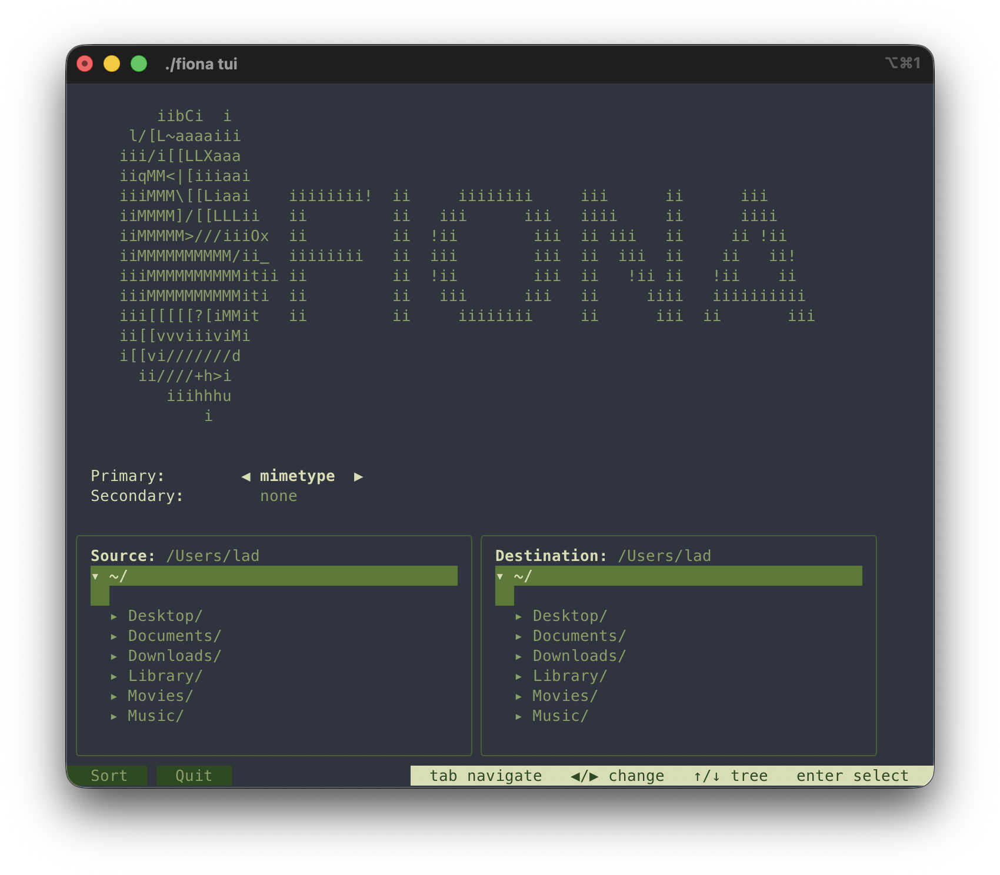

# FIONA

<p align="center">
  
</p>

<p align="center">
  <strong>F</strong>ile <strong>I</strong>ntelligent <strong>O</strong>rganization & <strong>N</strong>avigation <strong>A</strong>ssistant
</p>

<p align="center">
  A cross-platform file organizer written in Go that automatically sorts files based on configurable rules with ML-powered image classification.
</p>

<p align="center">
  <a href="https://go.dev/"></a>
  <a href="LICENSE"></a>
  <a href="https://goreportcard.com/report/github.com/lookinalx/fiona"></a>
</p>

---

## 📋 Table of Contents

- [Features](#-features)
- [Installation](#-installation)
- [Quick Start](#-quick-start)
- [Commands](#-commands)
- [Data Safety](#-data-safety)
- [Sorting Criteria](#-sorting-criteria)
- [ML Classification](#-ml-classification)
- [Examples](#-examples)
- [Development](#-development)
- [Roadmap](#-roadmap)
- [License](#-license)



---

## ✨ Features

- **Smart File Sorting** — organize files by MIME type, extension, date, size, or a combination
- **ML Image Classification** — sort photos into semantic categories using CLIP zero-shot classification
- **Hierarchical Organization** — primary + secondary criteria (e.g., `images/jpg/`, `2025/01/`)
- **Parallel Processing** — multi-worker execution for fast operation on large directories
- **Conflict Resolution** — auto-rename (default), skip, or replace on filename collision; a replaced file goes to trash, never deleted
- **Dry-Run Mode** — `--dry-run` prints the full operation plan and changes nothing
- **Copy or Move** — choose whether originals are preserved or relocated
- **Metadata Preservation** — maintains file permissions and modification times
- **Write-Ahead Journal** — the whole plan is written to disk before the first file is touched
- **Undo/Rollback** — reverse any run, even an interrupted one, with a preview and confirmation
- **Progress Bar** — real-time progress during execution
- **TUI Interface** — interactive terminal UI for browsing, configuring, and monitoring sort operations
- **Cross-Platform** — single binary for Windows, Linux, and macOS

---

## 🚀 Installation

### Pre-built Binaries (recommended)

Download the latest release from [GitHub Releases](https://github.com/lookinALX/FIONA/releases/latest):
- `fiona` — main binary
- `fiona-classifier` — required for ML classification (`-c ml`)

Place both files in the same directory and run.

### Build from Source

**Requirements:** Go 1.21+

```bash
git clone https://github.com/lookinALX/FIONA.git
cd FIONA
go build -o fiona ./cmd/fiona
```

**For ML classification**, also build the Python classifier:

```bash
cd ml
pip install -r requirements.txt
pyinstaller \
  --onefile \
  --strip \
  --name fiona-classifier \
  --exclude-module matplotlib \
  --exclude-module scipy \
  --exclude-module notebook \
  --exclude-module jupyter \
  --exclude-module IPython \
  --exclude-module tkinter \
  --exclude-module PyQt5 \
  --exclude-module wx \
  --exclude-module torchaudio \
  --exclude-module cv2 \
  --exclude-module sklearn \
  --exclude-module pandas \
  --exclude-module numpy.testing \
  --exclude-module unittest \
  --exclude-module xmlrpc \
  --exclude-module email \
  --exclude-module html \
  --exclude-module http.server \
  classifier.py
# binary will be in ml/dist/fiona-classifier
```

Place `fiona-classifier` in the same directory as the `fiona` binary.

---

## 🎯 Quick Start

```bash
# Sort the top-level files of Downloads by MIME type: shows the plan and asks before executing
fiona sort -s ~/Downloads -d ~/Organized -c mimetype

# Only preview, change nothing
fiona sort -s ~/Downloads -d ~/Organized -c mimetype --dry-run

# Execute immediately, including subdirectories
fiona sort -s ~/Downloads -d ~/Organized -c mimetype -r --yes

# Sort photos using ML classification
fiona sort -s ~/Photos -d ~/Photos/Sorted -c ml

# Undo the last run of a destination directory
fiona undo --dest ~/Organized
```

---

## 📖 Commands

FIONA uses subcommands:

```
fiona sort [OPTIONS]    — sort files
fiona undo [OPTIONS]    — reverse a previous sort using its journal
fiona --version         — print version
fiona --help            — print help
```

### sort flags

| Flag | Short | Default | Description |
|------|-------|---------|-------------|
| `--criteria` | `-c` | `mimetype` | Primary sorting criterion |
| `--then` | `-t` | — | Secondary sorting criterion |
| `--source` | `-s` | current dir | Source directory |
| `--dest` | `-d` | current dir | Destination directory; created right before execution if missing |
| `--action` | `-a` | `copy` | `copy` or `move` |
| `--on-conflict` | — | `rename` | `rename`, `skip`, `replace` (the old file goes to trash) |
| `--recursive` | `-r` | off | Scan subdirectories too |
| `--hidden` | — | off | Include files and directories starting with a dot |
| `--dry-run` | `-n` | off | Print the plan and exit; stronger than `--yes` |
| `--yes` | `-y` | off | Execute without confirmation |
| `--workers` | `-w` | CPU count × 2 | Number of parallel workers, 1 or more |
| `--log` | — | `<dest>/.fiona/runs` | Directory to write the run journal to |
| `--ml-config` | — | — | Path to custom ML categories JSON (only with `-c ml`) |

Without `--dry-run` and `--yes` FIONA prints the plan, asks `Would you like to continue? [y/N]` and executes only on `y` or `yes`.

All flags are validated together before anything is touched: every error is printed, and the exit code is 1. The exit code is also 1 if any operation fails or the run is interrupted.

### undo flags

| Flag | Short | Default | Description |
|------|-------|---------|-------------|
| `--log` | — | — | Journal file of the run to undo (`<run-id>.jsonl`) |
| `--dest` | `-d` | current dir | Undo the last run of this destination that is not undone yet; cannot be combined with `--log` |
| `--dry-run` | `-n` | off | Print the undo preview and exit |
| `--yes` | `-y` | off | Execute without confirmation |
| `--workers` | `-w` | CPU count × 2 | Number of parallel workers, 1 or more |

---

## 🛡️ Data Safety

**What is scanned.** By default only regular files at the top level of the source. With `-r` FIONA goes into subdirectories, but never into bundles (`.app`, `.bundle`, `.framework`, `.photoslibrary`, `.xcodeproj`) or projects (directories containing `.git`, `.hg`, `.svn`, `node_modules`, `go.mod` or `package.json`). Hidden entries are skipped unless `--hidden` is given. Symlinks and special files are never followed or sorted; they are reported in the plan as `Skipped by scanner`. If the destination lies inside the source, it is not scanned.

**Nothing is overwritten.** Every conflict is resolved in the plan, before execution:

| `--on-conflict` | Behaviour |
|-----------------|-----------|
| `rename` (default) | the new file gets the first free name: `photo_1.jpg`, `photo_2.jpg`, … |
| `skip` | the source file stays where it is |
| `replace` | the existing file is moved to `<dest>/.fiona/trash/<run-id>/`, then the new one takes its place |

Trash of runs older than 5 days is removed automatically the next time a sort is executed in the same destination.

**Journal.** Each executed run writes `<dest>/.fiona/runs/<run-id>.jsonl` (JSON Lines): the whole plan first, then the result of every operation. If the journal cannot be created, no file is touched.

**Undo.** `fiona undo` shows what it is going to do and asks for confirmation. It moves files back (or removes copies), returns replaced files from trash and removes the directories the run created if they are empty. A file that was changed after the run (different size or modification time) or whose original location is occupied is skipped, never overwritten. A run interrupted by Ctrl+C or a crash can be undone too. A journal that points outside of its own source and destination is rejected as a whole. Each run can be undone once.

### Upgrading from 0.3.x

- Scanning is not recursive and skips hidden files; the old behaviour is `-r --hidden`.
- `--on-conflict` defaults to `rename` instead of `replace`.
- `--dry-run` is off by default and never executes anything; `--force yes` is removed, use `--yes`.
- The journal is `<dest>/.fiona/runs/<run-id>.jsonl` instead of `fiona_logs.json` in the current directory. Old journals cannot be used for undo.
- `--workers 0` is an error.
- The exit code is 1 if any operation fails.

---

## 🗂️ Sorting Criteria

| Criterion | Flag value | Result structure |
|-----------|-----------|-----------------|
| MIME type | `mimetype` | `images/`, `documents/`, `videos/`, ... |
| Extension | `extension` | `jpg/`, `pdf/`, `mp4/`, ... |
| Full date | `date` | `2025-01-15/` |
| Year | `year` | `2025/` |
| Month | `month` | `01/` |
| Size | `size` | `small/`, `medium/`, `large/` |
| ML | `ml` | `people/`, `animals/`, `food/`, ... |

Combine primary and secondary criteria for nested structure:

```bash
# mimetype → extension: images/jpg/, documents/pdf/
fiona sort -c mimetype -t extension -s ~/Photos

# year → month: 2025/01/, 2025/02/
fiona sort -c year -t month -s ~/Documents
```

---

## 🤖 ML Classification

When using `-c ml`, FIONA spawns `fiona-classifier` — a standalone Python binary with a CLIP model — classifies all images in the source directory, and sorts them into semantic category folders.

### Default Categories

| Category | Description |
|----------|-------------|
| `people` | Portraits, selfies, group photos |
| `family` | Family gatherings, relatives |
| `pets` | Dogs, cats, domestic animals |
| `nature` | Landscapes, forests, mountains |
| `food` | Meals, restaurants, cooking |
| `travel` | Trips, landmarks, sightseeing |
| `events` | Parties, weddings, celebrations |
| `sports` | Athletic activities, fitness |
| `home` | Rooms, furniture, interiors |
| `vehicles` | Cars, motorcycles, aircraft |
| `work` | Office, desks, meetings |
| `documents` | Scans, receipts, printed text |
| `screenshots` | Screen captures, app UIs |
| `other` | Everything else |

### Custom Categories

Pass a JSON config file with custom category names and CLIP prompts:

```json
{
  "dad": "a photo of my father, an older man with grey hair",
  "vacation_2024": "photos from our summer vacation in Italy",
  "cats": "a photo of a cat"
}
```

```bash
fiona sort -s ~/Photos -d ~/Sorted -c ml --ml-config ~/my_categories.json
```

### Non-Image Files

Files that cannot be opened as images (PDFs, videos, text files) are automatically classified by MIME type and sorted alongside images without interrupting the operation.

### ML Log

After each run, `fiona-classifier` writes a detailed log to `ml_log_results.json` in the working directory containing confidence scores for every classified image.

### Requirements

- `fiona-classifier` binary must be in the same directory as `fiona`
- GPU is used automatically if available (CUDA), otherwise CPU

---

## 💡 Examples

### Organize Downloads by type, move files, rename on conflict

```bash
fiona sort \
  -s ~/Downloads \
  -d ~/Downloads/Organized \
  -c mimetype \
  -a move \
  --on-conflict rename \
  --yes
```

**Result:**
```
Organized/
├── images/
│   ├── photo.jpg
│   └── screenshot.png
├── documents/
│   ├── report.pdf
│   └── notes.txt
├── videos/
│   └── clip.mp4
└── archives/
    └── backup.zip
```

### Sort photos using ML classification

```bash
fiona sort -s ~/Photos -d ~/Photos/Sorted -c ml --yes
```

**Result:**
```
Sorted/
├── people/
│   └── portrait.jpg
├── pets/
│   ├── dog1.jpg
│   └── dog2.jpg
├── food/
│   └── pizza.jpg
├── nature/
│   └── sunset.png
└── documents/
    └── scan.pdf
```

### Sort photos by year then month

```bash
fiona sort -s ~/Pictures -d ~/Pictures/Archive -c year -t month -a copy
```

**Result:**
```
Archive/
├── 2025/
│   ├── 01/
│   └── 03/
└── 2024/
    └── 12/
```

### Preview before executing

```bash
fiona sort -s ~/Documents -d ~/Sorted -c mimetype
# Shows plan, asks for confirmation

Would you like to continue? [y/N]

fiona sort -s ~/Documents -d ~/Sorted -c mimetype --dry-run
# Shows plan and exits
```

### Undo a previous sort

```bash
# the last run of a destination directory
fiona undo --dest ~/Organized

# a specific run
fiona undo --log ~/Organized/.fiona/runs/20261010-153012-a1b2.jsonl
```

---

## 🛠️ Development

### Project Structure

```
FIONA/
├── cmd/fiona/
│   └── main.go
├── internal/
│   ├── cli/             # flags, validation, config
│   ├── scanner/         # directory traversal, file metadata
│   ├── rules/           # sorting rule implementations
│   ├── sorter/          # planner, executor, reverter
│   ├── journal/         # write-ahead run journal (JSON Lines)
│   └── types/           # shared types (Action, LogEntry, etc.)
├── ml/
│   ├── classifier.py    # FastAPI server with CLIP model
│   ├── requirements.txt # Python dependencies
│   └── test_classifier.py
├── tests/
│   └── integration_test.go
├── go.mod
└── README.md
```

### Running Tests

```bash
# All tests
go test ./...

# With race detector
go test -race ./...

# Integration tests only
go test ./tests -v

# With coverage
go test -cover ./...

# Python classifier tests
cd ml && pytest test_classifier.py -v
```

### Adding a New Rule

Implement the `Rule` interface:

```go
type Rule interface {
    GetDestination(fi *types.FileInfo) string
}
```

Register in `internal/cli/flags.go`:

```go
var ruleFactories = map[string]ruleFactory{
    "myrule": func(isPrimary bool) rules.Rule {
        return &rules.MyRule{IsPrimary: isPrimary}
    },
}
```

---

## 🗺️ Roadmap

### ✅ Milestone 1 — Core (Complete)
- File scanning with full metadata
- Rule-based sorting: mimetype, extension, date, year, month, size
- Primary + secondary criteria with nested directory structure
- Dry-run preview with tree visualization
- Copy / move with conflict resolution (replace, skip, rename)
- Metadata preservation (permissions, modification time)
- Cross-filesystem move support

### ✅ Milestone 2 — Performance & Robustness (Complete)
- Parallel processing with configurable worker pool
- Real-time progress bar
- Transaction logging to JSON
- Undo / rollback via `fiona undo`
- Subcommand CLI (`sort`, `undo`)

### ✅ Milestone 3 — ML Image Classification (Complete)
- FastAPI Python server with CLIP model (`fiona-classifier` binary)
- Batch image classification via HTTP
- Go subprocess management — start/stop `fiona-classifier` automatically
- `ByMLRule` — sort files by ML-assigned tags
- Fallback to MIME type for non-image files
- Custom categories via JSON config file
- `--ml-config` flag wired into CLI
- `fiona-classifier` PyInstaller build optimisation (271 MB, CPU-only)

### 📅 Milestone 4 — TUI Interface
- Interactive terminal UI (bubbletea / lipgloss)
- Browse source directory and select files before sorting
- Live preview of the sort plan in the terminal
- Real-time progress with file-level status
- Undo history browser

### 📅 Milestone 5 — Web Interface
- REST API with `net/http`
- Browser-based UI with embedded assets
- Real-time operation monitoring

### 📅 Future
- `fiona analyze` — unsupervised clustering + LLM to suggest folder structure automatically
- Watch mode for continuous directory monitoring
- Duplicate detection and deduplication
- Cloud storage integration (S3, Google Drive, Dropbox)
- Plugin system for custom rules

---

## 📄 License

MIT — see [LICENSE](LICENSE)

---

**Made with ❤️ and Go — [@lookinALX](https://github.com/lookinALX)**